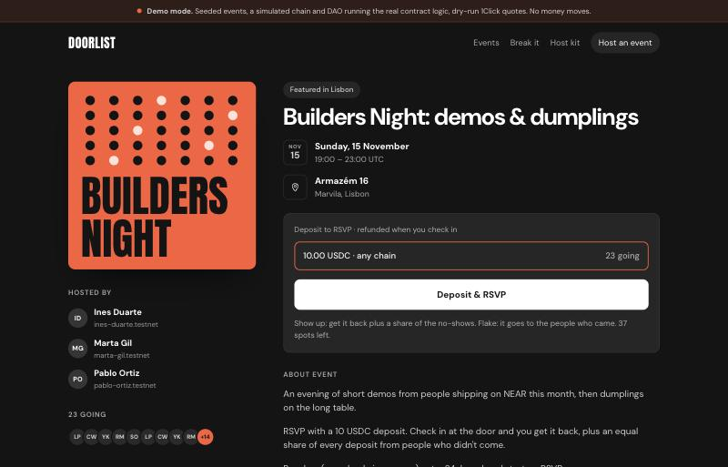

# You're invited to try Doorlist

**What:** RSVP to a meetup with a small deposit. Show up and get it back plus a share of the no-shows. Flake and your deposit goes to the people who came.
**When:** whenever you run `go run ./cmd/doorlist`
**Where:** http://localhost:8080 (no keys, no accounts, no wallet: it starts in a labelled demo mode)
**Dress code:** Go 1.25+. Nothing else for the app. Rust only if you want to run the contract's own tests. The first `go run` or `go test` on a fresh machine downloads Go modules and can take a few minutes on a slow connection; after that the tests finish in seconds.

Built at NEAR HACKATHON, track **Social Money**.



**The problem.** Free events fill up on paper and sit half empty on the night. Hosts over-invite to compensate, and the people who did come get a worse room. A deposit fixes that only if guests can pay it without friction (most don't hold NEAR) and if nobody has to trust the host with the money.

---

## For judges: the five-minute path

| Do | See |
|---|---|
| `go run ./cmd/doorlist`, open http://localhost:8080 | Five seeded events: one with doors open now, two upcoming (one of them regulars-first), two settled |
| Open **Builders Night** → **Deposit & RSVP** → name, "USDC · Base", any `0x…` address → **Get my deposit address** | A live NEAR Intents 1Click quote (`dry: true`): the exact amount to send so that 10 USDC lands on NEAR |
| **Simulate the deposit (demo)** | Your ticket: a QR code, a six-letter code, and the money stages (Deposited → Checked in → Refunded + share) |
| **Host an event** → **Continue as demo host** → **Rooftop Demo Hour** → **Open the door scanner** | The phone makes its own ed25519 door key and scans tickets with the camera. No camera? Type `DOO-RDE`: "IN." |
| Back on the host page: **Close & pay out** | One DAO Transfer proposal per attendee, approved; the no-show row is struck through |
| Open http://localhost:8080/t/zk-reading-club/SHOWEDUPDEMOAAAA | "YOU SHOWED UP. +1.36 USDC" and a payout receipt |
| Open http://localhost:8080/break | 19 attacks on the ledger, run on page load: "19 of 19 refused" |
| `go test ./...` | 7 packages ok, 32 tests |
| `cd contract/rust && cargo test` | 12 passed (the deployable contract) |
| `make verify` | Re-reads the real testnet event below and checks every number, no keys: "all checks passed" |

Screenshots (demo mode, seeded data) are in [`docs/screens/`](docs/screens): the event page on desktop and at 375 px, the paid ticket, the break-it page and the poster. A narrated two-minute script is in [`docs/demo-script.md`](docs/demo-script.md).

---

## Proof: one real event on NEAR testnet

On 13 November 2026 Doorlist ran one complete event on **NEAR testnet**: five guests RSVP'd with deposits, three were checked in at the door, the host closed it, and a real Sputnik DAO paid the three attendees their deposit back plus the two no-shows' deposits.

| | |
|---|---|
| Contract | [`dl.doorlist-hk1113.testnet`](https://testnet.nearblocks.io/address/dl.doorlist-hk1113.testnet) (the Rust contract in `contract/rust`) |
| Pot | [`doorlist-hk1113.sputnikv2.testnet`](https://testnet.nearblocks.io/address/doorlist-hk1113.sputnikv2.testnet), a Sputnik DAO created from the testnet factory |
| Money | `usdc.fakes.testnet`, a testnet stand-in for USDC (6 decimals, anyone can mint, worth nothing). NEAR Intents has no testnet, so nobody paid from another chain |
| Guests | `ana`, `bo`, `cy`, `di`, `eli` `.doorlist-hk1113.testnet`: test accounts we created and control. They are not real people |
| Result | 25 test-USDC deposited · 3 checked in · each attendee paid **8.333333** · 0.000001 rounding dust left in the DAO · 0 left in the contract |

| Step | Transaction |
|---|---|
| Deploy and initialise the contract | [tx](https://testnet.nearblocks.io/txns/BGChKSUn41BG9iNd3T8dV7a9pT1QYTWizzkeX3F6t68q) |
| Create the Sputnik DAO that holds the pot (factory `sputnikv2.testnet`; council = host, `doorlist` role = the contract, Transfer only) | [tx](https://testnet.nearblocks.io/txns/GQE3khgkn8jNXEnHFhToUm5yhTi4k3sLwuSqPiUDdGW6) |
| Host creates the event: 5 test-USDC deposit, capacity 10 | [tx](https://testnet.nearblocks.io/txns/2t7tg51c2nmikW3VMkwfYYYjLdVfAN7M92UKpMumeXon) |
| Host registers a door key | [tx](https://testnet.nearblocks.io/txns/6GRxTcvs222kE4Amybvc5RHTydNFLMwnHitMSThsL5qQ) |
| `ana` RSVPs: `ft_transfer_call` of 5 test-USDC; the contract forwards it to the DAO in the same transaction | [tx](https://testnet.nearblocks.io/txns/AXZkERXRJPbBxbu6Yg25ZDrRP3fyM6kJpcQerovXFfUf) |
| `bo` RSVPs: `ft_transfer_call` of 5 test-USDC; the contract forwards it to the DAO in the same transaction | [tx](https://testnet.nearblocks.io/txns/C4MnrcDbwhFmrRT1orPJibzCDDYsy2wrtpXHeyRwp3ov) |
| `cy` RSVPs: `ft_transfer_call` of 5 test-USDC; the contract forwards it to the DAO in the same transaction | [tx](https://testnet.nearblocks.io/txns/47z4QWCuyFUpCy8m6WyfXF9MQV3TCVDhaXFcMATLZqqZ) |
| `di` RSVPs: `ft_transfer_call` of 5 test-USDC; the contract forwards it to the DAO in the same transaction | [tx](https://testnet.nearblocks.io/txns/H1CeJgn6vzjBk4mPBvdDERM3HimrHdHUNW2GGTq9WE2r) |
| `eli` RSVPs: `ft_transfer_call` of 5 test-USDC; the contract forwards it to the DAO in the same transaction | [tx](https://testnet.nearblocks.io/txns/Fd6gGGbsYbSXWhJ9WyJ6vFAE5sbt7jQxxHoM6HM9r8MW) |
| Door signs `ana`'s check-in; the relayer submits it; the contract verifies the ed25519 signature | [tx](https://testnet.nearblocks.io/txns/FPn3E3EivSYfn5qVivCRYHnqEx7nHDMmQMgUUJqE4PBs) |
| Door signs `bo`'s check-in; the relayer submits it; the contract verifies the ed25519 signature | [tx](https://testnet.nearblocks.io/txns/DTYjKVJgvUpogc36AWpfGm632GQuhWN2TP5YDg8dXHkG) |
| Door signs `cy`'s check-in; the relayer submits it; the contract verifies the ed25519 signature | [tx](https://testnet.nearblocks.io/txns/d2cqrezKoo7aX5N3GV7mNGpfkkndX1cnBk2oMv6Ud6y) |
| Host closes the event: 3 of 5 came, so each attendee is owed 5 + 10/3 | [tx](https://testnet.nearblocks.io/txns/4F6JniVFBPPnFVQQEnFWBWpbbUPq2gEVJ5yLv6Y1THSS) |
| Payout batch 1: the contract files and approves DAO proposals #0 and #1; the DAO sends 8.333333 to `ana` and `bo` | [tx](https://testnet.nearblocks.io/txns/9DRxBZDMMa9ziFi25MuhK6NQSjjKZ8QHZGPGcAACjJ6E) |
| Payout batch 2: proposal #2; the DAO sends 8.333333 to `cy` | [tx](https://testnet.nearblocks.io/txns/6SAyBoHucHWNDyuf3XWfRCM6Rvk8YCNtC5nuSnVEVxLt) |

All 38 transactions, including account creation, token registration and test-USDC minting, are listed in [`docs/testnet/run.json`](docs/testnet/run.json). Every transaction was signed and sent by this repo's own Go code (`internal/near`, driven by `cmd/doorctl`), the same code live mode uses.

**Check it yourself, without keys:**

```
make verify        # or: go run ./cmd/doorctl verify
```

It reads the event, every RSVP, the DAO's proposals and each wallet's test-USDC balance from testnet RPC, and checks: attendees were paid deposit + share; no-shows forfeited; the DAO holds only the rounding dust; the contract holds nothing; one approved proposal per attendee; each check-in counted toward reputation. Output from 13 November:

```
✓ ana.doorlist-hk1113.testnet paid deposit + share = 8.333333
✓ bo.doorlist-hk1113.testnet paid deposit + share = 8.333333
✓ cy.doorlist-hk1113.testnet paid deposit + share = 8.333333
✓ di.doorlist-hk1113.testnet forfeited their deposit
✓ eli.doorlist-hk1113.testnet forfeited their deposit
✓ check-in count matches the RSVP records (3)
✓ DAO keeps only the rounding dust: 0.000001 test-USDC
✓ the Doorlist contract itself holds no deposits (0.00)
✓ DAO approved one Transfer proposal per attendee (3)
...
all checks passed
```

What this run does not show: a real meetup, real people, real money, the 1Click cross-chain deposit path, or the browser door scanner talking to the chain (check-ins here were signed by the same code in Go).

---

## RSVP (as a guest)

1. Scan the event QR on the poster or open the link.
2. Deposit 10 USDC from any chain: USDC on Base, Arbitrum, Solana or Ethereum, USDT on Tron, ETH, SOL, BTC, or USDC from a NEAR account. A 1Click deposit address takes whatever you send and settles exactly the deposit as USDC on NEAR. You never need a NEAR wallet.
3. You're on the list. Keep the ticket link: it is your way in.

Your name is shown to the host and is never written on chain. On chain you are `base:0x…` (or your NEAR account), a ticket code and a deposit.

## At the door (as a host)

1. Open `/door` on your phone (from the host page). The phone generates a door key in the browser; you register it for the event once.
2. Scan the guest's QR: they're checked in, and the deposit is marked for refund. The check-in is signed by the door key, so the contract accepts it without a wallet popup per guest. Camera broken? Type the six-letter code.
3. Close the event: no-show deposits split equally among everyone who came, and payouts run on their own.

## The pot

- Deposits do not sit in the Doorlist contract. `ft_on_transfer` records the RSVP and forwards the USDC to the event's **Sputnik DAO** in the same transaction.
- The DAO's council is the hosts. The Doorlist contract holds one extra role, `doorlist`, that may only add and approve `Transfer` proposals. On close it files one proposal per attendee (`deposit + forfeit / shows`) and approves it. Every payout is a DAO proposal anyone can read.
- Integer division leaves at most `shows − 1` micro-USDC; that dust stays in the DAO. If nobody shows up, everything stays in the DAO for the council to decide.
- Example: 40 going at 10 USDC, 31 show. Forfeit 90 USDC. Each attendee gets 12.903225 USDC; 0.000025 stays in the DAO.

**Attendance is reputation.** Each check-in adds one to the guest's count in the contract (`get_shows`). An event can open early to people with N past shows ("Regulars first"). The count is not taken on faith: `GET /api/aura/<guest>` recomputes it from the RSVP history and reports whether it matches.

## For hosts: FAQ

**Do my guests need a wallet or NEAR?** No. They pay from the chain they already use and get paid back there.

**Do I?** Yes, a NEAR wallet. Sign-in is a NEP-413 signed message through NEAR Connect, with Meteor Wallet as the suggested wallet; any NEAR wallet in the connector works.

**Can I run off with the pot?** Not alone. It sits in a DAO whose council you choose; payouts that match the check-in list need no vote, anything else needs the council.

**What if my phone dies at the door?** Any phone can become a door: open the door page there and register it (up to 8 per event). The typed-code fallback works on any browser.

**A guest gave their ticket to a friend.** Fine. The ticket is the bearer; the payout still goes to the address that paid.

**What does it cost?** NEAR gas (fractions of a cent per check-in) and the 1Click swap fee the guest sees in the quote. Doorlist takes nothing.

**Running a real one?** [`kit/host-checklist.md`](kit/host-checklist.md) and the printable poster at `/e/<event>/poster`.

---

## Where it stands

| | |
|---|---|
| ✅ | Guest flow end to end in demo mode: quote → deposit (simulated) → ticket QR → check-in → close → payout receipt |
| ✅ | Ledger rules, tested: 32 Go tests, 12 Rust tests, a 19-attack suite |
| ✅ | Deployable Rust contract: builds to a 219 KB wasm with `cargo near build`, ABI generated |
| ✅ | Door scanner: in-browser ed25519 key, camera scan (native detector or bundled decoder), typed-code fallback |
| ✅ | Real 1Click prices in the RSVP flow (`dry: true`), with a labelled offline estimate when the API is unreachable |
| ✅ | Printable QR poster, host checklist, MCP server for agents, Dockerfile and Koyeb config |
| ✅ | **One complete event on NEAR testnet**: contract deployed, real Sputnik DAO holding the pot, 5 RSVPs, 3 door-signed check-ins, close, 3 DAO-approved payouts. `make verify` re-checks it live |
| ✅ | The Go transaction signer used by live mode sent all 38 testnet transactions |
| ⚠️ | The web app's live mode (pages reading the testnet contract, wallet sign-in in the browser, the browser door scanner on chain) has not been run end to end; the testnet run used the command-line runner |
| ⚠️ | The near-sdk-go version of the contract type-checks but was not compiled to wasm (see [`contract/README.md`](contract/README.md)) |
| ❌ | No mainnet deployment, no real money, no real meetup yet |
| ❌ | The 1Click cross-chain deposit path has only been priced (`dry: true`), never executed; cross-chain payout forwarding is designed, not built |
| ❌ | Invite codes, encrypted guest names inside invite links, passkey or email sign-in for guests |
| ❌ | The app keeps guest names and quotes in memory; a restart in live mode loses names (the ledger is unaffected) |

## What is real and what is simulated

| Piece | In the demo |
|---|---|
| Ledger rules (RSVP, check-in, close, split, payout state) | **Real code.** `contract/core`, the same state machine as the Rust contract, with real ed25519 signatures |
| 1Click quotes | **Real API**, `dry: true`: real prices, no deposit address, priced to a placeholder recipient |
| The chain, the USDC token, the Sputnik DAO | **Simulated in process** in the demo app. The testnet run above used the real ones (with a test token) |
| The deposit arriving | **Simulated** by the "Simulate the deposit" button |
| Events, guests, names, amounts | **Seeded**, deterministic, invented. All accounts end in `.testnet` and do not exist |
| Host sign-in | **Skipped**: "Continue as demo host" |

No number in the demo is a usage figure. Doorlist has had no real users; the testnet guests are our own test accounts.

## What can go wrong

- **The relayer is trusted for cross-chain guests.** 1Click settles to the relayer, which then deposits into the contract on the guest's behalf, and their payout returns through the relayer's outbox. A dishonest relayer could keep a deposit before it reaches the contract. Guests paying from a NEAR account skip the relayer entirely.
- **The host is trusted at the door.** A host can check in friends who aren't there. Door signatures stop everyone else from faking a check-in, not the host. Mitigation: every check-in is public, with the door key that signed it.
- **One person, several addresses.** "One RSVP per address" does not stop someone booking twice from two wallets. They pay two deposits and can only show up once, so it costs them.
- **A lost ticket link is a lost ticket** until the host looks the guest up by code.
- **Payout proposals can fail** (DAO out of storage on the token, guest account not registered with USDC). The RSVP stays "paying" and the council can approve or retry in the DAO.
- **Clocks.** A door signature is accepted within 15 minutes of block time; a phone with a badly wrong clock is refused.
- **near-sdk-go** is a young community SDK; we did not deploy with it. Details in [`contract/README.md`](contract/README.md).

## Remove NEAR and this stops

- **NEAR Intents (1Click).** Without it every guest needs the right token on the right chain and a wallet for it. "Pay from wherever you are" is the whole RSVP.
- **A NEAR contract** holds the rules: who paid, which door keys count, who was checked in, what each person is owed. Native `ed25519_verify` makes a browser-generated door key enough to authorise a check-in.
- **Sputnik DAO** holds the money, so neither the app nor a single host does, and every payout is a public proposal.
- **Named accounts and NEP-413** give hosts a readable identity and a sign-in without a password.
- Without these, Doorlist is a spreadsheet and a payment link, and the host holds the cash.

## For developers

```
go test ./...                          → 7 packages ok, 32 tests
cd contract/rust && cargo test         → 12 passed
make wasm                              → contract/rust/target/near/doorlist_contract.wasm
```

```
cmd/doorlist/        the server (one binary; templates and assets embedded)
cmd/doorctl/         testnet runner (run) and keyless checker (verify)
cmd/doorlist-mcp/    MCP server over stdio: list_events, event_pot, start_rsvp, ticket_status, aura
internal/event/      events, guests, the demo chain, the live chain, the break-it suite
internal/pot/        USDC maths, projections, the Sputnik DAO policy
internal/checkin/    tickets, QR payloads, door signatures
internal/intents/    NEAR Intents 1Click client
internal/near/       transaction signing, RPC, NEP-413 verification
contract/core/       the ledger in Go        contract/rust/  the deployable contract
web/templates/       templ views             web/static/     CSS, door scanner, vendored htmx and QR decoder
scripts/             testnet deploy, DAO creation, event creation
kit/                 host checklist for a real meetup
```

**Stack.** Go `net/http`, templ, htmx. No JS framework; the only scripts are the door scanner and the wallet sign-in. Hand-written CSS on a classless base.

**Going live (testnet).** `scripts/deploy-testnet.sh`, then `scripts/create-dao.sh`, then copy `.env.example` to `.env` and set `DOORLIST_MODE=live`. NEAR Intents has no testnet, so real cross-chain deposits (`DOORLIST_LIVE_QUOTES=1`) mean mainnet and small amounts.

**Hosting.** `Dockerfile` and `koyeb.yaml` are included; `/healthz` is the health check.

**Agents.** `DOORLIST_URL=http://localhost:8080 go run ./cmd/doorlist-mcp` speaks MCP on stdio.

### Built when, and with what

Everything in this repository was written during the hackathon window, 10–13 November 2026. There is no earlier code.

Third-party code: [htmx](https://htmx.org) 2.0.4 and [jsQR](https://github.com/cozmo/jsQR) 1.4.0 (vendored in `web/static/vendor`), [templ](https://templ.guide), [rsc.io/qr](https://pkg.go.dev/rsc.io/qr), near-sdk (Rust), near-sdk-go, NEAR Connect (loaded from a CDN in live mode only). Fonts: Anton and DM Sans.

License: [MIT](LICENSE).
